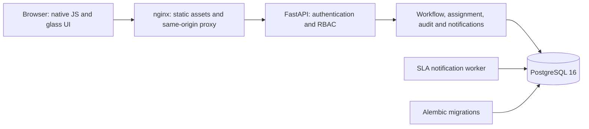

# Architecture

## Repository baseline

The supplied project contained FastAPI, SQLAlchemy, Argon2/JWT helpers, basic users/tickets/assets/knowledge/audit models and a draft Compose file. There were no frontend source files or tests. Existing asset and knowledge functionality was preserved. The unsafe/unfinished auth and ticket routes were replaced within the existing `/api/v1` API prefix. No existing source control metadata was present.

The original deficiencies and phased implementation plan are recorded in [IMPLEMENTATION_PLAN.md](IMPLEMENTATION_PLAN.md).

## Runtime topology

Only nginx is published by Compose. The backend and database communicate using Compose service names. The worker starts after backend readiness. The backend readiness check performs an actual database query. On local non-Docker development, FastAPI also serves frontend files.

## Persistence

Original tables: `users`, `categories`, `sla_policies`, `tickets`, `ticket_comments`, `assets`, `asset_history`, `knowledge_articles`, `audit_logs`.

Added tables: `subcategories`, `teams`, `locations`, `engineers`, `engineer_skills`, `engineer_subskills`, `auth_sessions`, `login_attempts`, `ticket_assignments`, `ticket_status_history`, `notifications`, `system_settings`, `attachments`, `ticket_requests`.

Role permissions remain a centralized role enum and backend permission gates, rather than introducing redundant role/join tables. Legacy roles remain compatible. Categories, subcategories and skills use foreign keys. Team/location names on user and ticket records are routing values/snapshots; editing a team/location label does not rewrite historical ticket routing values. Deactivate an old routing value and configure the replacement as part of a controlled change.

Engineer profiles reference user identities. Disabling an engineer or changing their role is blocked while they own active tickets. Availability can be turned off without affecting existing work. Capacity cannot be reduced below active workload. Ticket deletion is soft, preserving comments, attachment references and audit history.

Attachments are PostgreSQL binary records, deferred during metadata queries. Database and attachment backup consistency is automatic, at the cost of increased database size.

## Transactions and concurrency

Ticket creation, its unique reference, SLA deadlines, assignment, audit events, status history and notification rows commit together. Assignment/capacity operations obtain a PostgreSQL transaction advisory lock. Ticket mutations also lock the ticket row. PostgreSQL sequences, rather than `count(*)`, generate IDs; gaps after rollbacks are expected.

A requester-scoped hash of `Idempotency-Key` links a creation request to its fingerprint and ticket. Retries with the same body return the original ticket. Different content with the same key is rejected. Bulk operations commit once; an invalid ticket or transition rolls back the whole batch.

SQLite supports development/tests but does not implement PostgreSQL advisory locks. Use PostgreSQL for production assignment guarantees.

## Assignment

Eligibility: active engineer account → available profile → below capacity → category skill. Optional fallback considers available generalists only when no eligible category match exists. Scored assignment considers category, subcategory, team, location, utilization, existing high/critical work and approaching/overdue SLA work. Least-workload and round-robin are alternative strategies. Last assignment time and stable user ID break ties.

The configuration does not retroactively reassign existing tickets. Administrators review unassigned tickets and manually assign them. Both old and new engineer, actor, timestamp and reason are persisted in assignment records and audit events.

## SLA and notifications

SLA policies are keyed by priority and define first-response and resolution targets. New tickets snapshot deadlines. First engineer activity acknowledges the request. Resolution and closure have separate timestamps. Reopening starts a new resolution target. Priority edits recalculate targets relative to creation; this may reveal an immediate breach.

SLA warnings are inserted by the worker with one bulk database statement and unique deduplication keys. The key includes recipient, ticket, event and deadline. Each requester/engineer receives one approaching and one breached event for a deadline. Notifications are persisted in the ticket transaction for immediate ticket events. The notification table is the in-app delivery store; additional transports should consume committed events with their own delivery/retry ledger.

No email, Slack, Teams, or scheduled external messages are sent by this implementation.

## Frontend

Native ES modules keep authentication, reusable UI, ticket screens, administration and dashboards separate. All database data is fetched through the API. The session token is an HttpOnly cookie; JavaScript only retains the CSRF token. Theme preference is the only persistent browser-local setting.

All user-controlled content is escaped before HTML insertion. The description editor supports bold markup and lists as text, with safe preview. Tables scroll inside cards on small screens. Search is debounced, data is paginated, and stale routes render into detached containers rather than overwriting the current screen.

## Performance

SQL pagination and filters bound ticket, user, engineer and audit lists. Related names and workloads are fetched in grouped queries. Composite indexes support requester scope, engineer active work, status/priority, deadlines and audit lookups. PostgreSQL trigram indexes support ticket text search. Conversation/activity streams are paginated in 100-record batches. CSV exports are limited to 100 selected tickets.

The benchmark script creates 100,000 synthetic tickets, 501 users and 50 engineers in a disposable schema. Its results are local query measurements, not a production concurrency or availability guarantee. See [VERIFICATION.md](VERIFICATION.md).
