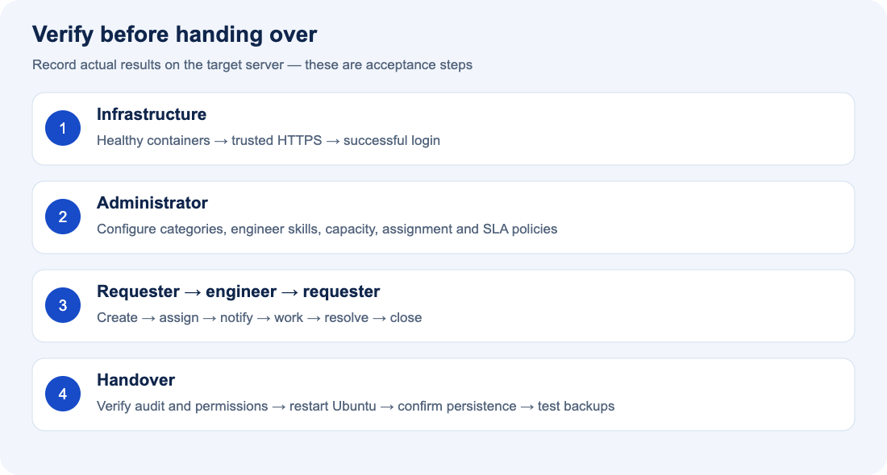

# Samsung D2C IT Service Desk — Product and User Guide

## 1. What the tool does

Samsung D2C IT Service Desk gives employees a central place to request IT help and follow progress. Engineers use it to organize assigned work, communicate with requesters and record resolutions. Administrators manage accounts, routing, service targets and operational oversight.

A ticket brings the issue description, requester, priority, engineer, conversation, attachments and activity history together. Instead of relying on separate messages, everyone permitted to access the ticket can follow its recorded progress.

**Planned production URL:** `https://107.108.42.60:5050` on Ubuntu. The deployment guides describe installation; this document does not claim that the target server is already live. The examples below are illustrative and are not production records.

## 2. Who uses it?

| Role | Main purpose | What the role can access |
|---|---|---|
| Employee — USER | Request help and track the result | Own tickets, comments, attachments, notifications and permitted knowledge articles |
| Support engineer — ENGINEER | Investigate and resolve assigned requests | Assigned tickets and personal requests; work controls apply to assigned tickets |
| Administrator — ADMIN | Manage the service desk | All nondeleted tickets, account/engineer management, configuration, analytics and audit logs |

Permissions are enforced by the server. Hiding an Admin Console menu is not the only access control. Engineers do not automatically gain access to every employee ticket. An engineer's personal request remains subject to requester permissions when another engineer owns the work.

## 3. Workspace navigation

| Menu | Use it to |
|---|---|
| Overview | See role-appropriate ticket totals, trends, recent updates and workload |
| Tickets | Search and filter the tickets your role permits you to see |
| My tickets | Focus on your personal requests |
| Unassigned | Administrator view of tickets needing manual routing |
| Create ticket | Submit a new IT request |
| Knowledge base | Search published guidance; engineers/admins can publish articles |
| Analytics | Review role-scoped volume, status, priority, category, location and engineer information |
| Users & accounts | Administrator account creation, editing, roles, activation and password reset |
| Engineers | Administrator skills, availability, capacity and workload management |
| Configuration | Administrator category, team/location, SLA, assignment and notification settings |
| Engineer activity | Administrator historical assignment/completion tracker, CSV reports and email delivery status |
| Audit logs | Administrator search and review of recorded actions |
| Notifications | Read ticket updates and follow links to tickets |
| My settings | Maintain permitted profile details and change your password |

The theme button switches between light and dark mode and remembers the preference in that browser. On smaller screens, use the navigation button to open the sidebar. Tables can scroll within their panels.

## 4. Employee walkthrough

### Sign in

1. Open the service URL supplied by IT and confirm that HTTPS loads without a certificate warning.
2. Enter the work email and password assigned to your account.
3. Review Overview or open My tickets. If you cannot sign in, contact the service desk administrator; a self-service password-reset email flow is not connected.
4. Use logout when finished, especially on a shared workstation. Sessions expire; saving after expiry may require signing in again.

### Create a useful request

1. Select **Create ticket**.
2. Enter a concise title, such as “VPN disconnects after a few minutes.”
3. Describe what happened, when it started, the impact, the error message and any troubleshooting already tried. Do not include passwords or access tokens.
4. Choose the configured category and subcategory, priority, and applicable routing/location details.
5. Add relevant permitted evidence, such as a screenshot or log. Check that it does not contain unnecessary personal or customer information.
6. Submit and wait for confirmation. Record the generated reference, for example `D2C-2026-001284`.
7. Review the ticket to confirm its status, assigned engineer and SLA deadline. If an attachment fails, review the error and upload it again through the ticket detail screen; verify the file appears before leaving.

Categories and locations come from administrator configuration. They are not guaranteed to exist on a fresh installation. A clear description and appropriate category improve routing; selecting Critical does not guarantee immediate resolution.

### Follow up and finish

Open the ticket from My tickets or a notification. Read the conversation and add requested information in a comment. Once the engineer resolves the issue, check the result and close the resolved ticket. If the same issue remains, reopen the ticket when the configured policy permits it. If reopening is unavailable, contact IT or create a new request referencing the earlier ticket.

## 5. How a ticket moves through the system

The illustration summarizes a typical lifecycle and handover checks. The table below explains the workflow states. Administrators can change display labels, so your screen may use slightly different wording.

| State | Meaning | Typical next action |
|---|---|---|
| OPEN | Request recorded and awaiting assignment | Automatic routing or administrator assignment |
| ASSIGNED | Engineer selected | Engineer acknowledges or starts work |
| IN_PROGRESS | Engineer is investigating | Add updates, request information or resolve |
| WAITING_FOR_USER | Information/action needed from requester | Requester replies; engineer resumes work |
| WAITING_FOR_VENDOR | External assistance is needed | Engineer tracks progress and resumes work |
| RESOLVED | Engineer recorded a resolution | Requester verifies and closes or reopens |
| CLOSED | Requester/service desk has completed the ticket | Reopen only if policy and permissions allow |
| REOPENED | Issue returned for further work | Routing and SLA are reassessed |
| CANCELLED | Administrator cancelled the request | Review the recorded reason/history |

This is not a requirement to visit every state. The backend checks transitions and role permissions. Engineers must provide resolution text when resolving. Resolution and closure have separate timestamps. Administrative overrides still have validation requirements.

### Example: VPN issue

An employee submits a Network/VPN request with connection logs. The system saves the ticket, calculates its deadlines and chooses an eligible engineer. The engineer sees the assignment notification, starts work and asks for the time of the last disconnect. The employee replies. The engineer records the fix and resolves the request. The employee verifies a stable connection and closes it. The timeline and administrative audit history retain the recorded actions.

## 6. Engineer walkthrough

1. Open Overview to review assigned work, high-priority requests, due/overdue tickets and workload.
2. Open a ticket and read its description, conversation, evidence and SLA information.
3. Start work using an available status action. Staff activity such as starting work or commenting can record the first response.
4. Add a public comment to communicate with the requester. Where appropriate, use an internal note for support-only discussion; internal notes are restricted to authorized staff.
5. Move to a waiting state when another party needs to act, and explain what is needed.
6. Upload relevant troubleshooting evidence if necessary.
7. Resolve the ticket with a clear explanation of the cause, action taken and anything the employee should verify.

Waiting states do not pause SLA time in the current implementation. Do not assume moving to a waiting state stops the deadline. If assignment or workload needs to change, contact an administrator for reassignment or profile changes.

## 7. Automatic and manual assignment

Assignment runs on the server when a ticket is created. The system checks whether automatic assignment is enabled, then considers engineers whose accounts are enabled, profiles are available, skills match and active workloads are below capacity.

| Strategy | Selection approach |
|---|---|
| Least workload | Fewest active tickets, with assignment history and stable ID as tie-breakers |
| Round-robin | Least recent assignment among eligible engineers |
| Scored | Configured weights for category/subcategory, team/location, free capacity and existing priority/SLA pressure |

An optional generalist fallback can be enabled by an administrator. Without an eligible engineer, the ticket remains unassigned and its reason is recorded for administrative review. Availability changes do not automatically redistribute existing tickets.

Administrators assign or reassign through the ticket controls, selecting an eligible engineer and supplying a reason when appropriate. The previous/new engineer, actor and timestamp are recorded. Reassignment and capacity checks are performed by the backend.

## 8. Administrator operating guide

### Initial configuration

After the first administrator has been bootstrapped during deployment:

1. Create the required categories/subcategories, teams and locations.
2. Create employee and engineer accounts with appropriate roles.
3. Configure engineer category/subcategory skills, availability and capacity.
4. Review SLA response/resolution targets for each priority.
5. Choose and enable the assignment strategy and any fallback settings.
6. Review notification preferences, SLA warning window and reopen policy.
7. Run a complete test request before opening the service to employees.

### Daily administration

Review unassigned, critical and overdue requests. Check engineer utilization before reassignment. Use account search to find users and update their permitted details, roles or account status. Administrator password reset revokes sessions and can unlock the account.

An engineer with active tickets must have those tickets reassigned before deactivation or role removal. Capacity cannot be reduced below the existing active workload. Turning availability off stops new automatic allocations without removing current work.

Ticket lists support manual edits and bounded bulk changes to assignment, priority or status. Bulk operations are validated together; an invalid selection can reject the batch. Selected-ticket CSV exports are limited to 100 tickets. Treat exported data as internal information.

Disabling or deleting an account deactivates it. Ticket deletion is soft deletion. These operations do not erase all historical records.

## 9. SLA and analytics explained

An SLA policy defines a **first-response target** and a **resolution target**. Tickets store deadlines based on the policy used when the relevant workflow operation runs. The UI identifies tickets within SLA, approaching their deadlines or overdue.

| Term | Meaning |
|---|---|
| Response time | Time until qualifying staff activity acknowledges the request |
| Resolution time | Time until the recorded resolution |
| SLA approaching | Deadline is within the configured warning window |
| SLA breached | The relevant target deadline has passed without its required outcome |
| Capacity | Maximum active tickets permitted for an engineer |
| Utilization | Current active workload relative to configured capacity |

SLAs currently use elapsed calendar time, including waiting states; business-hours calendars are not connected. Changing a policy does not rewrite every existing deadline. Priority changes and reopening can recalculate targets. Check the actual deadline on the ticket rather than assuming a generic priority-to-hours mapping.

Overview provides operational summaries; Analytics provides additional breakdowns. All figures are scoped to the current role. A personal dashboard and an administrator dashboard may therefore show different totals without either being incorrect.

## 10. Search, notifications and attachments

Search ticket references, text and related identity information, then narrow results with the available status, priority, category, engineer, team/location, date, SLA and assignment filters. Search results remain subject to permissions and are paginated.

Notifications include creation, assignment/reassignment, comments, status changes, resolution/closure and SLA warnings/breaches when enabled. Use **View ticket** to open the related request or **Mark all as read** to clear unread indicators. Notifications are in-app; assignment/reassignment emails can also be enabled with an approved SMTP relay. Slack and Teams are not connected. SLA events depend on the background worker running.

Allowed attachment formats include PNG/JPG/JPEG, PDF, TXT/LOG/CSV, DOCX/XLSX and ZIP. The current default maximum is 10 MiB per file, with up to 100 attachments per ticket. The system validates format and access permissions, but does not provide antivirus scanning. Only open evidence from an appropriate source and follow your organization's endpoint/security policy.

## 11. Activity history versus audit logs

The ticket activity timeline helps requesters and engineers follow progress using information safe for their scope. The Admin Console audit view supports broader operational review with actor, timestamp, action, entity and applicable before/after information.

Audit records cannot be edited through normal application APIs and database triggers reject ordinary modification/deletion. A privileged database owner can bypass database protections; this is not an independent tamper-proof archive. See the [Security Review](SECURITY_REVIEW.md) for the exact boundary.

## 12. Common questions

| Question | Explanation / action |
|---|---|
| Why is no engineer assigned? | No eligible engineer may match the category, availability or capacity, or auto-assignment may be disabled. An administrator reviews Unassigned. |
| Why can I not see another ticket? | Visibility depends on requester/assignment and role. Ask an administrator if access is required. |
| Why can I not reopen? | The ticket state or configured reopen window may not permit it. Contact IT with the ticket reference. |
| Why did saving fail? | Check validation feedback, session expiry or a concurrent change; refresh and confirm the latest state before retrying. |
| Why did my upload fail? | Check format, content, size and the per-ticket limit. The message should describe the rejected condition. |
| Why did changing my password sign me out? | Password changes revoke sessions; sign in using the new password. |
| Where is the reset-password email? | No self-service email reset provider is connected. Contact an administrator. |
| Why is SLA overdue while waiting? | Waiting does not pause elapsed-calendar-time SLA targets. |
| Is the site already deployed? | These documents describe the target deployment. Ask the service owner for its current availability. |

## 13. Presentation summary

For a short stakeholder demonstration, show: employee login → ticket creation → automatic assignment → engineer investigation/comment → resolution → employee closure → administrator audit review. Then show the engineer workload view and explain configurable assignment and SLA policies.

The tool provides a shared record of IT work, role-specific access, consistent routing, visible deadlines and traceable changes. Production rollout still depends on approved infrastructure, operational ownership and closure or acceptance of the documented security gaps.

Further reading:

- [Ubuntu installation with images](UBUNTU_INSTALLATION.md)
- [Security review submission](SECURITY_REVIEW.md)
- [Architecture](ARCHITECTURE.md)
- [API reference overview](API.md)
- [Verification report and limitations](VERIFICATION.md)
