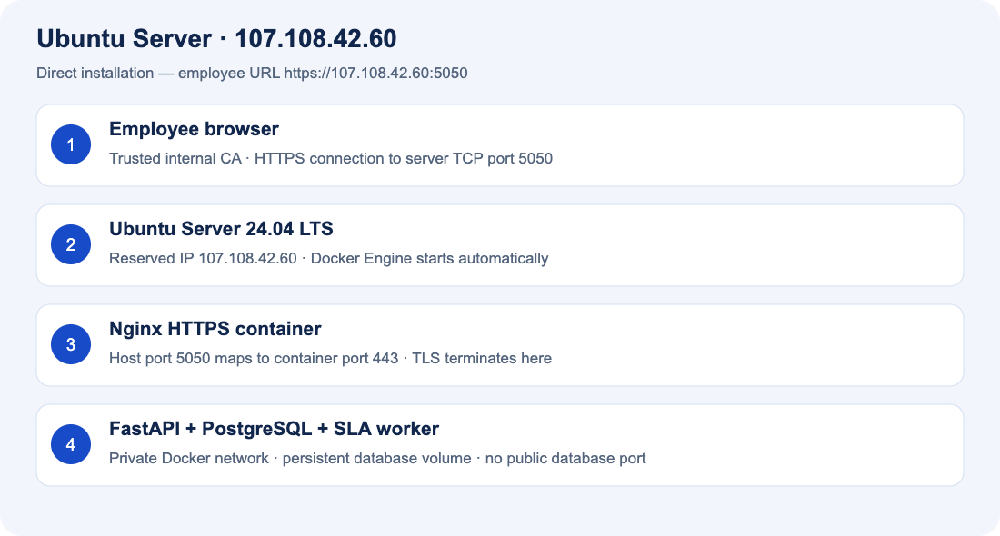
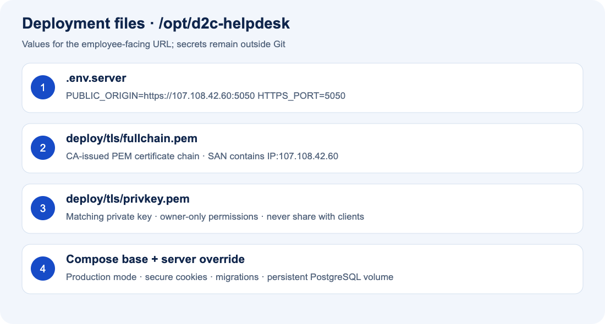
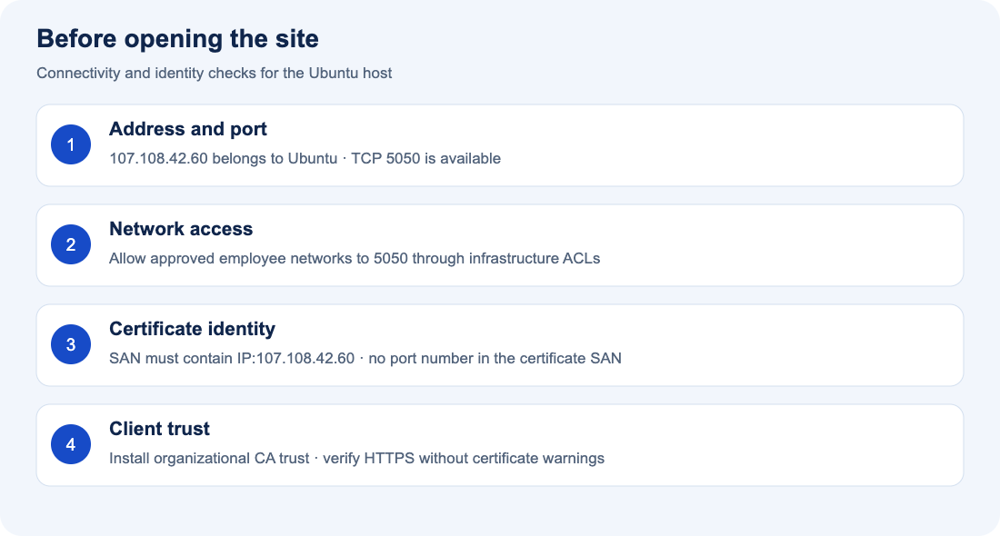

# Samsung D2C — Ubuntu installation with images

**Target URL: https://107.108.42.60:5050**

Install directly on **Ubuntu Server 24.04 LTS (64-bit)**. This guide assumes Ubuntu itself owns the reserved IP `107.108.42.60`. No Windows host, Hyper-V or TCP forwarding is needed. All commands run in Ubuntu Bash unless marked otherwise. Installation on the actual server remains unverified; the images are explanatory diagrams, not screenshots from that server.

## 1. Prepare the Ubuntu server



Use an existing Ubuntu installation or install Ubuntu Server 24.04 LTS from the [official Ubuntu download](https://ubuntu.com/download/server). During installation select your language, create a non-root administrator, enable OpenSSH, and use the network values supplied by IT. On a new server only, select its intended installation disk; do not repartition an existing server that contains data.

| Requirement | Value |
|---|---|
| Server address | Reserved `107.108.42.60`, assigned to Ubuntu |
| Network settings | Obtain gateway, subnet prefix and DNS from IT; do not guess them |
| Starting resources | 4 CPUs, 8 GB RAM, 100 GB disk; increase storage for attachments and retention |
| Administrator | SSH account with sudo access |
| Application port | TCP 5050, available and allowed from employee networks |
| Certificate | Internal CA certificate with SAN `IP:107.108.42.60` and matching private key |
| GitHub access | Read access to private repository `gpandaaaa/D2C-TicketingTool` |
| Downloads | Ubuntu/Docker repositories, container registry, GitHub, Python package registry or approved mirrors |

From your workstation, replace the username and connect:

```bash
ssh YOUR_UBUNTU_USER@107.108.42.60
```

In Ubuntu:

```bash
cat /etc/os-release
ip -br address
ip route
getent hosts github.com
sudo ss -ltnp 'sport = :5050'
df -h
free -h
```

Confirm Ubuntu 24.04, the server IP, working routing/DNS and sufficient resources. No listener should already use 5050. If the IP is missing, ask IT to configure it using the correct interface/subnet; changing networking over SSH can disconnect you. Verify the SSH host fingerprint through your organization's trusted process on first connection.

## 2. Update packages

```bash
sudo apt-get update
sudo apt-get upgrade -y
```

If `/var/run/reboot-required` exists, reboot in a maintenance window with `sudo reboot`, then reconnect. On a shared server coordinate updates with its administrator.

## 3. Install Docker Engine

These commands target a fresh Ubuntu 24.04 server. If Docker/containerd is already installed, first review package conflicts in [Docker's Ubuntu guide](https://docs.docker.com/engine/install/ubuntu/).

```bash
sudo apt-get install -y ca-certificates curl git openssl
sudo install -m 0755 -d /etc/apt/keyrings
sudo curl -fsSL https://download.docker.com/linux/ubuntu/gpg -o /etc/apt/keyrings/docker.asc
sudo chmod a+r /etc/apt/keyrings/docker.asc
sudo tee /etc/apt/sources.list.d/docker.sources >/dev/null <<EOF_DOCKER
Types: deb
URIs: https://download.docker.com/linux/ubuntu
Suites: noble
Components: stable
Architectures: $(dpkg --print-architecture)
Signed-By: /etc/apt/keyrings/docker.asc
EOF_DOCKER
sudo apt-get update
sudo apt-get install -y docker-ce docker-ce-cli containerd.io docker-buildx-plugin docker-compose-plugin
sudo systemctl enable --now docker
sudo docker run --rm hello-world
sudo docker compose version
```

Expected: Docker's test container completes successfully and Compose is **2.24.4 or newer**. This guide uses `sudo docker`; adding an account to the Docker group grants root-equivalent control and is unnecessary here.

## 4. Download the private project

In Ubuntu Bash:

```bash
sudo mkdir -p /opt/d2c-helpdesk
sudo chown "$(id -un):$(id -gn)" /opt/d2c-helpdesk
git clone https://github.com/gpandaaaa/D2C-TicketingTool.git /opt/d2c-helpdesk
cd /opt/d2c-helpdesk
git log -1 --oneline
```

For HTTPS authentication, enter your GitHub username and an organization-approved repository-read token at Git's password prompt; GitHub account passwords do not authenticate Git operations. Alternatively use an approved read-only SSH deploy key. Never put the token in the URL, a document, a script or an environment file. See [GitHub authentication](https://docs.github.com/en/authentication/keeping-your-account-and-data-secure/about-authentication-to-github).

If cloning is unavailable, download the repository ZIP while signed in, transfer it using your approved file-transfer method, and extract the repository contents into `/opt/d2c-helpdesk`. Verify that `docker-compose.yml` is directly inside this directory.

## 5. Configure port 5050 and the database



In Ubuntu Bash:

```bash
cd /opt/d2c-helpdesk
umask 077
cp deploy/server.env.example .env.server
openssl rand -hex 32
nano .env.server
```

Paste the generated database password into `POSTGRES_PASSWORD`. The final file must have these values, with your generated password replacing the example text:

```dotenv
POSTGRES_DB=helpdesk
POSTGRES_USER=helpdesk
POSTGRES_PASSWORD=YOUR_GENERATED_HEX_PASSWORD
PUBLIC_ORIGIN=https://107.108.42.60:5050
HTTPS_PORT=5050
ACCESS_TOKEN_EXPIRE_MINUTES=480
```

Save with **Ctrl+O**, Enter, then exit with **Ctrl+X**. Run `chmod 600 .env.server`. Do not copy the local development `.env`. Production mode and secure cookies are enforced by `docker-compose.server.yml`; leave them enabled.

## 6. Install the HTTPS certificate

Obtain the certificate and chain from your internal PKI team. They must provide PEM files with a matching, server-readable private key. Transfer them through your approved secure mechanism. On Ubuntu, install them as:

```text
/opt/d2c-helpdesk/deploy/tls/fullchain.pem
/opt/d2c-helpdesk/deploy/tls/privkey.pem
```

In Ubuntu Bash:

```bash
mkdir -p deploy/tls
chmod 700 deploy/tls
# Place the two PEM files in deploy/tls before the following commands.
chmod 600 deploy/tls/privkey.pem
openssl x509 -in deploy/tls/fullchain.pem -noout -dates -ext subjectAltName
```

Confirm the SAN includes `IP Address:107.108.42.60` and the certificate has not expired. Ask IT to distribute the trusted root/intermediate CA certificates to employee Windows devices using Group Policy or their managed certificate process. Do not distribute the private key to clients or commit it to GitHub.

## 7. Allow employee network access



Have the network administrator allow employee source networks to **107.108.42.60 TCP 5050** and restrict SSH to approved management networks. Do not expose PostgreSQL 5432, backend 8000 or development port 3000. The server Compose override publishes only 5050, mapped to container HTTPS port 443.

For an existing UFW policy, inspect it with `sudo ufw status verbose`. Do not enable or reset UFW over SSH without first preserving the correct SSH management rule. Docker-published ports can bypass UFW: enforce source restrictions using your organization's upstream firewall/ACL or Docker-aware rules. A UFW allow rule alone does not restrict this container port. See [Docker firewall guidance](https://docs.docker.com/engine/install/ubuntu/#firewall-limitations).

Ask IT to test both an allowed employee network and a disallowed network before release. No router port-forward or Windows portproxy is required when clients can route directly to this Ubuntu address.

## 8. Start the application

In Ubuntu Bash, define this helper in each new terminal session:

```bash
cd /opt/d2c-helpdesk
dc() { sudo docker compose --env-file .env.server -p d2c-helpdesk -f docker-compose.yml -f docker-compose.server.yml "$@"; }
dc config --quiet
dc up -d --build --wait --wait-timeout 300
dc ps
dc exec frontend nginx -t
```

Expected: PostgreSQL, backend and frontend are healthy; worker is running. The first build needs network access and may take several minutes. Migrations run automatically. The development seed service does not start. Check errors with `dc logs --tail=100 backend frontend worker`.

Test TLS on the server using your internal CA chain file:

```bash
curl --fail --cacert /path/to/company-ca.pem \
  --resolve 107.108.42.60:5050:127.0.0.1 \
  https://107.108.42.60:5050/
```

Replace the CA path with its real location. This preserves the certificate's IP identity while connecting locally. Expected: application HTML, with no certificate error. Do not use `curl -k` as an acceptance test.


## 9. Open the site and create the first administrator

On an employee workstation open **https://107.108.42.60:5050** in its browser. For a terminal check on Linux/macOS, use `curl --fail https://107.108.42.60:5050/` with the internal CA installed, or supply `--cacert` as shown above.

Optional Windows workstation connectivity check (PowerShell):

```powershell
Test-NetConnection 107.108.42.60 -Port 5050
Start-Process 'https://107.108.42.60:5050'
```

Expected: TCP succeeds and the login page opens with a trusted HTTPS certificate. Always include **https://** and **:5050**. No HTTP redirect is configured.

Inside Ubuntu, create the initial administrator, replacing the example email and name with your real values:

```bash
dc exec backend python -m app.manage bootstrap-admin --email admin@example.local --name 'D2C Administrator'
```

Enter a unique password of at least 12 characters at the hidden prompt. Log in using that account. The bootstrap command refuses to create another administrator once one exists; manage subsequent accounts through the Admin Console.

## 10. Configure the platform and verify the ticket lifecycle


1. As ADMIN, create teams, locations, categories and subcategories.
2. Create an ENGINEER account; configure its matching category skills, availability and capacity above zero.
3. Review SLA policies and enable automatic assignment in Assignment Rules.
4. Create a USER account and log in using a separate browser profile/session.
5. Create a ticket in the matching category. Confirm a D2C ticket ID, SLA deadline and engineer assignment.
6. Upload a small allowed attachment, download it, and add a comment.
7. As ENGINEER, check the assignment notification, open the ticket, start work and resolve it with resolution text.
8. As USER, confirm the resolution and close the ticket. Test reopening within the configured policy.
9. As ADMIN, confirm creation, assignment, comment, attachment and status events appear in Audit Logs.
10. Confirm USER and ENGINEER accounts cannot access admin functions or unauthorized ticket/attachment data.

Record the ticket ID, test accounts, results and timestamp in your installation handover. Do not run the development browser test against the production database: it creates development records.


## 11. Verify startup after a reboot

Docker Engine was enabled in step 3. The application services use `restart: unless-stopped`, so running services restart when Docker starts. In an approved maintenance window:

```bash
sudo systemctl is-enabled docker
sudo reboot
```

Reconnect to Ubuntu, return to `/opt/d2c-helpdesk`, redefine the `dc` helper from step 8, and run `dc ps`. Confirm the URL works and your acceptance ticket, attachment and audit history are still present. Services deliberately stopped with `dc stop` need `dc start` or `dc up -d` to start again.


## 12. Back up and update

Database backups include accounts, tickets and attachments. In Ubuntu Bash:

```bash
mkdir -p "$HOME/d2c-backups"
chmod 700 "$HOME/d2c-backups"
umask 077
dc exec -T postgres sh -c 'pg_dump -U "$POSTGRES_USER" -d "$POSTGRES_DB" -Fc' > "$HOME/d2c-backups/helpdesk-$(date +%Y%m%d-%H%M%S).dump"
```

Copy backups to approved encrypted off-host storage, automate them, and test a restore in an isolated database. Back up `.env.server` and TLS keys separately in your organization's secret storage. A VM snapshot alone is not a tested backup. Never run `docker compose down -v`: it deletes the database volume.

Before an approved update take a backup; review migration changes, then run:

```bash
cd /opt/d2c-helpdesk
git pull --ff-only
dc up -d --build --wait --wait-timeout 300
dc ps
```

Repeat the login/ticket smoke checks. For certificate renewal replace the PEM files, then run `dc exec frontend nginx -t` followed by `dc exec frontend nginx -s reload`. Database-account separation, monitoring, backup scheduling and certificate renewal must be owned by infrastructure before production handover; see [security considerations](SECURITY.md).


## 13. Troubleshooting and handover

| Symptom | Check / fix |
|---|---|
| SSH or URL times out | Verify IP, routes, employee/management source network and upstream firewall |
| Port 5050 already used | Identify its owner with `sudo ss -ltnp 'sport = :5050'`; resolve the conflict |
| Private repository not found | Verify GitHub read permission and approved Git credentials |
| Compose rejects `!override` | Install Compose 2.24.4 or newer |
| Build download failure | Check DNS, proxy settings and approved registry/package mirrors |
| Certificate load error | Verify PEM file paths, matching key and permissions; inspect `dc logs frontend` |
| Certificate warning | Check IP SAN, chain, expiry and client CA trust; do not bypass verification |
| Login/session fails | Use HTTPS with :5050 and matching PUBLIC_ORIGIN; clear stale site cookies |
| Containers unhealthy | Inspect `dc logs --tail=100 postgres backend frontend worker` |
| Database login fails after env change | Changing the environment alone does not rotate an initialized DB password |
| Ticket unassigned | Check engineer enabled state, availability, category skills and spare capacity |
| SLA notifications missing | Check worker logs and notification rules |

Handover record:

- Ubuntu version, server IP, installed Docker/Compose versions and deployed Git commit.
- Named service owner, backup owner and certificate renewal owner.
- Successful login, ticket/attachment lifecycle, assignment, notifications and audit checks.
- Successful reboot/persistence check and isolated backup-restore test.
- Allowed and denied network-access checks, and remaining infrastructure actions.

This guide has been checked against the repository configuration. It is not evidence of installation on `107.108.42.60`. The bundled PostgreSQL account owns the schema; separating runtime/migration identities and setting up monitoring, backups and certificate renewal remain production infrastructure work. See [Security](SECURITY.md) and the [API overview](API.md).
