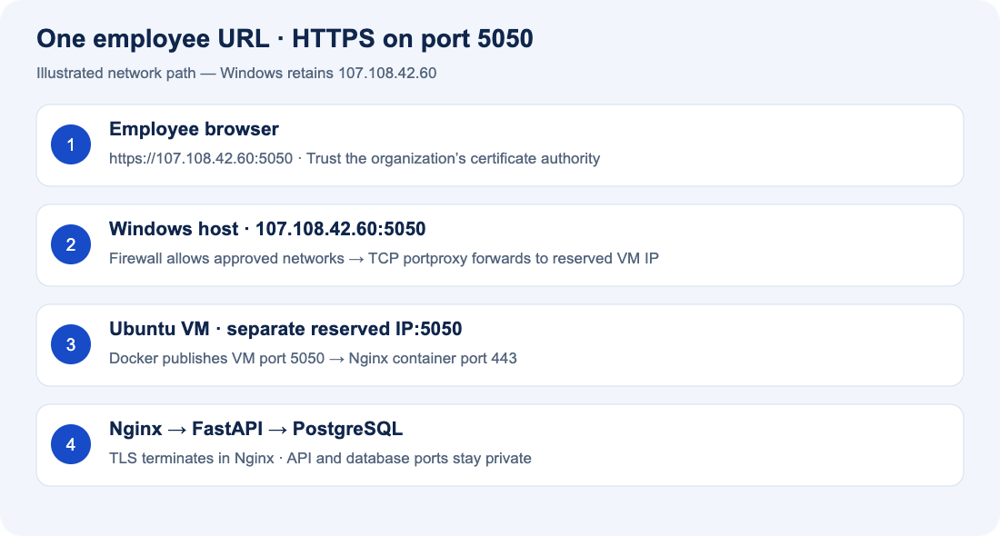
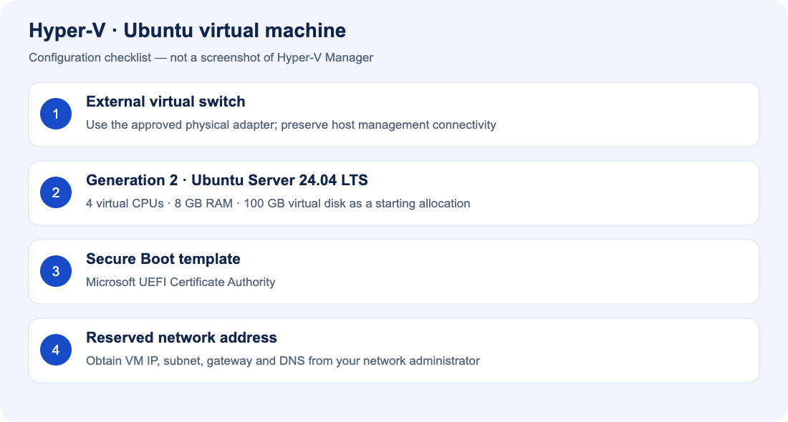
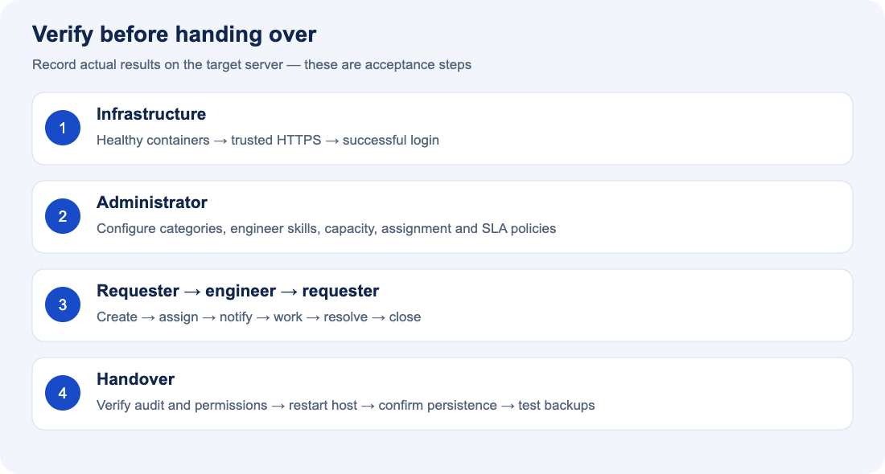

# Samsung D2C — Windows installation guide

**Employee URL: https://107.108.42.60:5050**  
**Host: Windows Server 2025, or Windows 11 Pro/Enterprise/Education**  
**Application runtime: Ubuntu Server 24.04 LTS VM + Docker Engine**

This guide assumes `107.108.42.60` belongs to the Windows host. The Ubuntu VM needs a separate, reserved IPv4 address from your network administrator. Do not assign the Windows host address to the VM. Installation on the target server has not been performed or verified. The illustrations below are explanatory diagrams, not server screenshots.

## 1. Understand the installation



Employees connect to Windows port **5050**. A Windows TCP forwarding rule sends the connection to Ubuntu port **5050**. Docker maps that port to Nginx **443**, where HTTPS terminates. PostgreSQL and the API have no published host ports.

Windows 11 and Windows Server 2025 are separate products. This guide uses a Linux VM for both because the project uses Linux container images; Docker Desktop does not support Windows Server. Windows 11 Home cannot enable Hyper-V: use an approved server/hypervisor instead. See [Docker Windows support](https://docs.docker.com/desktop/setup/install/windows-install/) and [Microsoft Hyper-V installation](https://learn.microsoft.com/en-us/windows-server/virtualization/hyper-v/get-started/Install-Hyper-V).

## 2. Prepare access and prerequisites

Have the following ready before starting:

| Item | Required value or action |
|---|---|
| Windows administrator access | Local console or approved remote administration |
| Windows host IP | Confirm `107.108.42.60` is assigned and reserved |
| VM IP | Obtain a different reserved IPv4 address, gateway, DNS and subnet prefix |
| Employee network | Obtain allowed source subnet(s) for the firewall rule |
| VM resources | Starting allocation: 4 virtual CPUs, 8 GB RAM, 100 GB disk; size backups/attachments separately |
| Virtualization | Enable Intel VT-x/AMD-V in firmware; if Windows itself is a VM, ask the hypervisor administrator about nested virtualization |
| Installation media | Download Ubuntu Server 24.04 LTS amd64 ISO from [Ubuntu](https://ubuntu.com/download/server) |
| GitHub | Read access to private repository `gpandaaaa/D2C-TicketingTool` |
| TLS | Internal CA-issued certificate with SAN **IP:107.108.42.60**, full chain and matching private key |
| Internet/mirrors | Ubuntu repositories, Docker repositories/registry, GitHub and Python package registry |

The certificate has no port number in its SAN. Employee devices must trust its issuing CA. Do not use the development seed or development passwords for this installation.

## 3. Identify Windows and check the port

Open **Start → PowerShell → Run as administrator**. All PowerShell blocks in this guide run on the Windows host; Bash blocks run inside Ubuntu.

```powershell
Get-ComputerInfo | Select-Object WindowsProductName, WindowsVersion, OsBuildNumber
Get-NetIPAddress -AddressFamily IPv4
Get-NetTCPConnection -LocalPort 5050 -State Listen -ErrorAction SilentlyContinue
systeminfo.exe
```

Confirm the IP and OS. No result from the port check means no existing TCP listener was found. If another service uses 5050, resolve that conflict before proceeding. Hyper-V requires supported virtualization hardware. Schedule the reboot and network change below with console access available: creating an external switch can interrupt remote access.

## 4. Enable Hyper-V — choose your OS

**Windows Server 2025 only**, elevated PowerShell:

```powershell
Install-WindowsFeature -Name Hyper-V -IncludeManagementTools -Restart
```

**Windows 11 Pro/Enterprise/Education only**, elevated PowerShell:

```powershell
Enable-WindowsOptionalFeature -Online -FeatureName Microsoft-Hyper-V -All
Restart-Computer
```

After restart, open **Start → Hyper-V Manager**. Server Core administrators can use Hyper-V Manager from a management workstation. Do not run both OS-specific commands. [Microsoft installation reference](https://learn.microsoft.com/en-us/windows-server/virtualization/hyper-v/get-started/Install-Hyper-V).

## 5. Create the virtual switch and Ubuntu VM



1. In Hyper-V Manager select the Windows host, then **Virtual Switch Manager**.
2. Use an existing approved external switch, or select **External → Create Virtual Switch**.
3. Name it `D2C-External`, select the physical adapter connected to the employee network, and retain **Allow management operating system to share this network adapter** if the host uses it. Apply the configuration.
4. Select **New → Virtual Machine**. Name it `D2C-Ubuntu`; choose **Generation 2**.
5. Allocate **8192 MB** memory, connect `D2C-External`, and create a **100 GB** virtual disk on an approved data volume.
6. Select the Ubuntu ISO as the boot installation media and finish the wizard.
7. Open VM **Settings → Processor**, set **4 virtual processors**. Under **Security**, use the **Microsoft UEFI Certificate Authority** Secure Boot template for Ubuntu.
8. Start and connect to the VM. Install Ubuntu Server, choose your locale and a strong administrator account, and enable **OpenSSH server**. Partition only the new VM disk.
9. In the installer network screen enter the VM's approved static address/subnet/gateway/DNS, or use an administrator-managed DHCP reservation. Record that address. Do not guess network values.
10. Finish installation, reboot, and eject the ISO if prompted.

See [Microsoft virtual-switch instructions](https://learn.microsoft.com/en-us/windows-server/virtualization/hyper-v/get-started/create-a-virtual-switch-for-hyper-v-virtual-machines). On a corporate network, the physical switch may also need to permit the VM's additional MAC address.

In Ubuntu Bash, verify:

```bash
ip -br address
ip route
getent hosts github.com
sudo apt-get update
sudo apt-get upgrade -y
```

Expected: the reserved VM address is present, a default route exists, GitHub resolves, and package updates succeed. Continue in the VM console or connect with `ssh YOUR_UBUNTU_USER@YOUR_VM_IP`, replacing both values.

## 6. Install Docker Engine inside Ubuntu

These commands target a fresh Ubuntu 24.04 VM. If Docker/containerd is already installed, first review package conflicts in [Docker's Ubuntu guide](https://docs.docker.com/engine/install/ubuntu/).

```bash
sudo apt-get install -y ca-certificates curl git openssl
sudo install -m 0755 -d /etc/apt/keyrings
sudo curl -fsSL https://download.docker.com/linux/ubuntu/gpg -o /etc/apt/keyrings/docker.asc
sudo chmod a+r /etc/apt/keyrings/docker.asc
sudo tee /etc/apt/sources.list.d/docker.sources >/dev/null <<EOF_DOCKER
Types: deb
URIs: https://download.docker.com/linux/ubuntu
Suites: noble
Components: stable
Architectures: $(dpkg --print-architecture)
Signed-By: /etc/apt/keyrings/docker.asc
EOF_DOCKER
sudo apt-get update
sudo apt-get install -y docker-ce docker-ce-cli containerd.io docker-buildx-plugin docker-compose-plugin
sudo systemctl enable --now docker
sudo docker run --rm hello-world
sudo docker compose version
```

Expected: Docker's test container completes successfully and Compose is **2.24.4 or newer**. This guide uses `sudo docker`; adding an account to the Docker group grants root-equivalent control and is unnecessary here.

## 7. Download the private project

In Ubuntu Bash:

```bash
sudo mkdir -p /opt/d2c-helpdesk
sudo chown "$(id -un):$(id -gn)" /opt/d2c-helpdesk
git clone https://github.com/gpandaaaa/D2C-TicketingTool.git /opt/d2c-helpdesk
cd /opt/d2c-helpdesk
git log -1 --oneline
```

For HTTPS authentication, enter your GitHub username and an organization-approved repository-read token at Git's password prompt; GitHub account passwords do not authenticate Git operations. Alternatively use an approved read-only SSH deploy key. Never put the token in the URL, a document, a script or an environment file. See [GitHub authentication](https://docs.github.com/en/authentication/keeping-your-account-and-data-secure/about-authentication-to-github).

If cloning is unavailable, download the repository ZIP while signed in, transfer it using your approved file-transfer method, and extract the repository contents into `/opt/d2c-helpdesk`. Verify that `docker-compose.yml` is directly inside this directory.

## 8. Configure port 5050 and the database


In Ubuntu Bash:

```bash
cd /opt/d2c-helpdesk
umask 077
cp deploy/server.env.example .env.server
openssl rand -hex 32
nano .env.server
```

Paste the generated database password into `POSTGRES_PASSWORD`. The final file must have these values, with your generated password replacing the example text:

```dotenv
POSTGRES_DB=helpdesk
POSTGRES_USER=helpdesk
POSTGRES_PASSWORD=YOUR_GENERATED_HEX_PASSWORD
PUBLIC_ORIGIN=https://107.108.42.60:5050
HTTPS_PORT=5050
ACCESS_TOKEN_EXPIRE_MINUTES=480
```

Save with **Ctrl+O**, Enter, then exit with **Ctrl+X**. Run `chmod 600 .env.server`. Do not copy the local development `.env`. Production mode and secure cookies are enforced by `docker-compose.server.yml`; leave them enabled.

## 9. Install the HTTPS certificate

Obtain the certificate and chain from your internal PKI team. They must provide PEM files with a matching, server-readable private key. Transfer them through your approved secure mechanism. On Ubuntu, install them as:

```text
/opt/d2c-helpdesk/deploy/tls/fullchain.pem
/opt/d2c-helpdesk/deploy/tls/privkey.pem
```

In Ubuntu Bash:

```bash
mkdir -p deploy/tls
chmod 700 deploy/tls
# Place the two PEM files in deploy/tls before the following commands.
chmod 600 deploy/tls/privkey.pem
openssl x509 -in deploy/tls/fullchain.pem -noout -dates -ext subjectAltName
```

Confirm the SAN includes `IP Address:107.108.42.60` and the certificate has not expired. Ask IT to distribute the trusted root/intermediate CA certificates to employee Windows devices using Group Policy or their managed certificate process. Do not distribute the private key to clients or commit it to GitHub.

## 10. Start the application

In Ubuntu Bash, define this helper in each new terminal session:

```bash
cd /opt/d2c-helpdesk
dc() { sudo docker compose --env-file .env.server -p d2c-helpdesk -f docker-compose.yml -f docker-compose.server.yml "$@"; }
dc config --quiet
dc up -d --build --wait --wait-timeout 300
dc ps
dc exec frontend nginx -t
```

Expected: PostgreSQL, backend and frontend are healthy; worker is running. The first build needs network access and may take several minutes. Migrations run automatically. The development seed service does not start. Check errors with `dc logs --tail=100 backend frontend worker`.

Before configuring Windows forwarding, test TLS inside the VM using your internal CA chain file:

```bash
curl --fail --cacert /path/to/company-ca.pem \
  --resolve 107.108.42.60:5050:127.0.0.1 \
  https://107.108.42.60:5050/
```

Replace the CA path with its real location. This preserves the certificate's IP identity while connecting locally. Expected: application HTML, with no certificate error. Do not use `curl -k` as an acceptance test.

## 11. Forward Windows port 5050 to Ubuntu

Run the following in **elevated Windows PowerShell**. Enter the actual reserved VM address and approved employee CIDR(s), not the Windows host address. Include the management workstation's subnet when needed.

```powershell
$D2cVmIp = Read-Host 'Reserved Ubuntu VM IPv4 address'
$D2cAllowedNetworks = (Read-Host 'Allowed employee CIDRs, comma separated').Split(',').Trim()
Test-NetConnection -ComputerName $D2cVmIp -Port 5050
```

Continue only if `TcpTestSucceeded` is `True`:

```powershell
Set-Service -Name iphlpsvc -StartupType Automatic
Start-Service -Name iphlpsvc
netsh interface portproxy add v4tov4 listenaddress=107.108.42.60 listenport=5050 connectaddress=$D2cVmIp connectport=5050 protocol=tcp
New-NetFirewallRule -DisplayName 'D2C HTTPS 5050' -Direction Inbound -Action Allow -Protocol TCP -LocalAddress 107.108.42.60 -LocalPort 5050 -RemoteAddress $D2cAllowedNetworks -Profile Any
netsh interface portproxy show v4tov4
```

Expected: one mapping from `107.108.42.60:5050` to the VM's `:5050`. Keep the IP Helper service and Windows IPv6 networking components enabled for portproxy. See [Microsoft netsh reference](https://learn.microsoft.com/en-us/windows-server/administration/windows-commands/netsh-interface).

Ask the network team to allow employee traffic to the Windows host on TCP 5050 and restrict **direct** VM port 5050 to the Windows host/approved administrators. Docker-published ports can bypass UFW rules, so use approved upstream ACLs or Docker-aware firewall controls; do not rely on UFW alone. [Docker firewall guidance](https://docs.docker.com/engine/install/ubuntu/#firewall-limitations).

**Audit limitation of this topology:** TCP portproxy preserves TLS but hides the original employee IP from Nginx. Audit IPs and IP-based login throttling see the forwarding host; user identity and account-based throttling still work. If per-client IP audit is required, have infrastructure deploy an approved reverse proxy and configure trusted forwarding explicitly, or route the service address directly to the VM. Do not blindly trust client-supplied forwarding headers.

## 12. Open the site and create the first administrator

On an employee Windows workstation:

```powershell
Test-NetConnection 107.108.42.60 -Port 5050
Start-Process 'https://107.108.42.60:5050'
```

Expected: TCP succeeds and the login page opens with a trusted HTTPS certificate. Always include **https://** and **:5050**. No HTTP redirect is configured.

Inside Ubuntu, create the initial administrator, replacing the example email and name with your real values:

```bash
dc exec backend python -m app.manage bootstrap-admin --email admin@example.local --name 'D2C Administrator'
```

Enter a unique password of at least 12 characters at the hidden prompt. Log in using that account. The bootstrap command refuses to create another administrator once one exists; manage subsequent accounts through the Admin Console.

## 13. Configure the platform and verify the ticket lifecycle



1. As ADMIN, create teams, locations, categories and subcategories.
2. Create an ENGINEER account; configure its matching category skills, availability and capacity above zero.
3. Review SLA policies and enable automatic assignment in Assignment Rules.
4. Create a USER account and log in using a separate browser profile/session.
5. Create a ticket in the matching category. Confirm a D2C ticket ID, SLA deadline and engineer assignment.
6. Upload a small allowed attachment, download it, and add a comment.
7. As ENGINEER, check the assignment notification, open the ticket, start work and resolve it with resolution text.
8. As USER, confirm the resolution and close the ticket. Test reopening within the configured policy.
9. As ADMIN, confirm creation, assignment, comment, attachment and status events appear in Audit Logs.
10. Confirm USER and ENGINEER accounts cannot access admin functions or unauthorized ticket/attachment data.

Record the ticket ID, test accounts, results and timestamp in your installation handover. Do not run the development browser test against the production database: it creates development records.

## 14. Make startup persistent and test a restart

Docker services use `restart: unless-stopped`; Docker Engine starts with Ubuntu. Enable automatic VM startup on Windows, in elevated PowerShell:

```powershell
Set-VM -Name 'D2C-Ubuntu' -AutomaticStartAction Start -AutomaticStartDelay 30 -AutomaticStopAction ShutDown
Get-VM -Name 'D2C-Ubuntu' | Select-Object Name, State, AutomaticStartAction
```

In an approved maintenance window restart the host. Confirm the VM starts, `dc ps` shows healthy services, the Windows forwarding rule remains, the URL works, and the ticket created above still exists. Disabling sleep on a Windows 11 host should follow your IT power policy.

## 15. Back up and update

Database backups include accounts, tickets and attachments. In Ubuntu Bash:

```bash
mkdir -p "$HOME/d2c-backups"
chmod 700 "$HOME/d2c-backups"
umask 077
dc exec -T postgres sh -c 'pg_dump -U "$POSTGRES_USER" -d "$POSTGRES_DB" -Fc' > "$HOME/d2c-backups/helpdesk-$(date +%Y%m%d-%H%M%S).dump"
```

Copy backups to approved encrypted off-host storage, automate them, and test a restore in an isolated database. Back up `.env.server` and TLS keys separately in your organization's secret storage. A VM snapshot alone is not a tested backup. Never run `docker compose down -v`: it deletes the database volume.

Before an approved update take a backup; review migration changes, then run:

```bash
cd /opt/d2c-helpdesk
git pull --ff-only
dc up -d --build --wait --wait-timeout 300
dc ps
```

Repeat the login/ticket smoke checks. For certificate renewal replace the PEM files, then run `dc exec frontend nginx -t` followed by `dc exec frontend nginx -s reload`. Database-account separation, monitoring, backup scheduling and certificate renewal must be owned by infrastructure before production handover; see [security considerations](SECURITY.md).

## 16. Troubleshooting

| Symptom | Check and corrective action |
|---|---|
| Hyper-V missing | Check Windows edition, firmware virtualization and nested virtualization support |
| VM cannot reach repositories | Verify external switch, VLAN, VM gateway/DNS and corporate proxy requirements |
| Private GitHub repository not found | Verify account/repository read permissions and approved Git authentication |
| Compose rejects `!override` | Upgrade Compose to 2.24.4+ |
| Database password error before start | Set the nonempty generated hex password in `.env.server` |
| Nginx certificate load failure | Check both PEM paths, matching key and PEM format; run `dc logs frontend` |
| Windows cannot connect to VM:5050 | Check `dc ps`, VM IP reservation, published port and network ACLs |
| Employee cannot reach host:5050 | Check portproxy, IP Helper, Windows firewall scope and upstream ACL |
| Certificate warning | Check IP SAN, expiry, full chain and client CA trust; do not bypass the warning |
| Login appears to succeed then expires | Use HTTPS and exact port; confirm `PUBLIC_ORIGIN`, clear old site cookies and retry |
| Ticket remains unassigned | Check enabled/available engineer, skills, capacity and assignment settings |
| After reboot site is unavailable | Check VM autostart, Docker service and whether the VM address changed |
| Password changed in env but DB rejects it | Environment changes do not rotate an initialized PostgreSQL password; perform a coordinated DB rotation |

To remove only the forwarding and firewall rule during a planned uninstall, use elevated PowerShell:

```powershell
netsh interface portproxy delete v4tov4 listenaddress=107.108.42.60 listenport=5050
Remove-NetFirewallRule -DisplayName 'D2C HTTPS 5050'
```

This does not delete the VM or database. Keep backups and data according to your retention policy.
